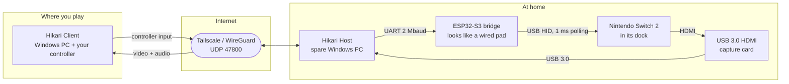

<h1 align="center">&nbsp;&nbsp;Hikari Remote Play</h1>

<p align="center">
  <b>Your Switch 2, anywhere.</b><br>
  Turn a Windows PC into your remote-play host with a $10 controller bridge. Play from anywhere with low latency.
</p>

<p align="center">
  <a href="https://github.com/thiagofnc/Hikari-remote-play/releases/latest"></a>
  <a href="https://github.com/thiagofnc/Hikari-remote-play/actions/workflows/ci.yml"></a>
  <a href="LICENSE"></a>
  
  
</p>

<p align="center">
  <a href="https://github.com/thiagofnc/Hikari-remote-play/releases/latest"></a>
  <br>
  <a href="docs/hardware-setup.md#2-flash-the-bridge-firmware"></a>
</p>

<p align="center">
  <a href="#get-playing-in-3-steps">Quick start</a> ·
  <a href="docs/user-guide.md">User guide</a> ·
  <a href="docs/hardware-setup.md">Hardware</a> ·
  <a href="docs/troubleshooting.md">Troubleshooting</a> ·
  <a href="docs/architecture.md">How it works</a>
</p>

---

## What it is

Hikari streams your docked Nintendo Switch 2 from home to wherever you are, and sends your controller back. You need a spare Windows PC at home with a USB 3.0 HDMI capture card for the picture. The console sees a small **ESP32-S3 board** as an ordinary wired USB controller. Hikari does not modify the console, does not run homebrew and does not need cloud servers.



## Highlights

<table>
  <tr>
    <td width="33%" valign="top">
      <h4>⚡ Built for latency</h4>
      The GPU handles colour conversion and encoding. Frames have deadlines instead of retransmissions, and every queue holds one item, so the newest data always wins.
    </td>
    <td width="33%" valign="top">
      <h4>🎮 Real wired controller</h4>
      The ESP32-S3 shows up as a HORI-style wired pad polled every 1 ms. It needs no Bluetooth pairing and no console modification.
    </td>
    <td width="33%" valign="top">
      <h4>🌙 Wakes your Switch</h4>
      Press <b>Play</b>. Hikari wakes the console with USB remote wakeup and a HOME press. An optional power-button circuit handles the rest.
    </td>
  </tr>
  <tr>
    <td valign="top">
      <h4>📶 Adapts to the network</h4>
      Bitrate follows queueing delay and loss, and XOR FEC adapts to the path. The resolution ladder steps down before 60 fps is given up.
    </td>
    <td valign="top">
      <h4>🔒 Paired, not open</h4>
      A pairing code like <code>K7QM-2XPA-9TRB</code> sets up a challenge-response handshake. After that, every control and input packet carries an HMAC tag.
    </td>
    <td valign="top">
      <h4>📊 Measured, not guessed</h4>
      Every stage records p50/p95/p99 histograms. A stats overlay, a latency-marker GPIO and probe tools let you check the numbers yourself.
    </td>
  </tr>
  <tr>
    <td valign="top">
      <h4>🕹️ Bring any pad</h4>
      Works with Xbox, DualShock 4, DualSense and keyboards. A Joy-Con-style mapping screen offers positional or label layouts and profiles.
    </td>
    <td valign="top">
      <h4>🔎 Zero configuration</h4>
      Hikari finds the bridge, the capture card, its audio and the fastest hardware encoder by itself. You never pick a COM port.
    </td>
    <td valign="top">
      <h4>📦 One app</h4>
      <code>Hikari.exe</code> is a single, self-contained executable. It asks once whether this PC is the Host or the Client.
    </td>
  </tr>
</table>

## Get playing in 3 steps

> [!TIP]
> Hikari is young software. Check the [Roadmap](#roadmap) and the [releases page](https://github.com/thiagofnc/Hikari-remote-play/releases) for what is shipped today.

**1. Wire it up at home** ([full guide](docs/hardware-setup.md))

```
Switch 2 dock ──HDMI──► capture card ──USB 3.0──► Host PC
Switch 2 dock ◄──USB── ESP32-S3 "USB" port
                       ESP32-S3 "UART" port ──USB──► Host PC
```

**2. Flash the bridge** (once, from the browser, no toolchain needed)

Download `hikari-bridge-esp32s3.bin` from the [latest release](https://github.com/thiagofnc/Hikari-remote-play/releases/latest). Plug the board's **UART** port into a PC and open <https://espressif.github.io/esptool-js/> in Chrome or Edge. Click **Connect**, set the flash address to **`0x0`**, choose the file and click **Program**.
From a clone of this repo, `scripts\flash-firmware.ps1` does the same from PowerShell. It finds the board, downloads the latest image, verifies its checksum and flashes it.

**3. Run `Hikari.exe` on both PCs**

| On the PC at home | On the PC where you play |
| --- | --- |
| Choose **Host**. The checklist should go green: bridge, capture card, audio and encoder. Note the **pairing code** and the PC's addresses (LAN and Tailscale `100.x`). | Choose **Client**. Pick your host from the LAN list, or type its address or Tailscale name, then enter the pairing code. Press **Play** (or **A** on your controller). |

For Internet play, install [Tailscale](https://tailscale.com/download) on both PCs and sign in with the same account. You don't need port forwarding. See the [user guide](docs/user-guide.md) for the full walkthrough.

## What you need

| Item | Notes |
| --- | --- |
| **Nintendo Switch 2 + dock** | Docked mode only, because the picture comes from the dock's HDMI output. |
| **Host PC** (stays at home) | Windows 10/11 with a **USB 3.0 port**. A GPU with a hardware H.264 encoder (Intel Quick Sync, NVIDIA NVENC or AMD AMF/VCN) is strongly recommended. An old laptop works. Use **Ethernet** if you can. |
| **USB 3.0 HDMI capture card** | Must deliver **uncompressed 1080p60** (NV12 or YUY2). Cheap USB 2.0 dongles only reach 1080p60 through MJPEG, or drop to 30 fps. That adds a decode stage and latency. |
| **ESP32-S3-DevKitC-1** (~$10) | Must be an **S3**, which has native USB. Boards with a CP2102N or CH343 UART bridge are auto-detected. |
| **2 USB cables** | One from the board's **USB** port to the dock, one from its **UART** port to the Host PC. Match your board revision (micro-USB or USB-C). |
| **HDMI cable** | Dock → capture card. |
| **Client PC** (where you play) | Windows 10/11 with hardware video decode (any GPU from the last decade). Wired or 5 GHz Wi-Fi. |
| *Optional:* PC817 optocoupler + 330 Ω resistor | Hardware power-button fallback for remote wake. See [remote wake](docs/remote-wake.md). |

## How it stays fast

Every stage has a budget, and every budget has a histogram. The numbers below are **design targets**, not measurements. Real hardware results go in [`docs/latency-budget.md`](docs/latency-budget.md).

| Stage | Technique | Target |
| --- | --- | --- |
| Capture | Media Foundation async reader, `MF_LOW_LATENCY`, uncompressed NV12 > YUY2 > MJPEG, uploaded once to the GPU | ┐ |
| Convert | D3D11 video processor: one fixed-function pass to NV12, frames never leave the GPU | ├ capture → encoded < 8–12 ms |
| Encode | Hardware MFT chosen **by measured p95 latency** (not by vendor); CBR with ~1-frame VBV, no B-frames, low-latency mode, IDR on demand | ┘ |
| Packetize | 1200-byte datagrams (fits the Tailscale MTU), paced sending, XOR FEC with adaptive group size | < 2 ms |
| Network | Per-frame deadlines and no retransmission; keyframe request on loss; ABR driven by queueing delay | depends on your path |
| Decode | Media Foundation hardware decode into D3D11 | receive → decoded < 8–12 ms |
| Present | Flip-model swap chain with tearing support; three presentation modes | decoded → display < 1 frame |
| Input (client) | Controllers polled at 1 kHz, change-driven send with redundant resends | sample → packet < 1–2 ms |
| Input (host) | Receive thread at `TIME_CRITICAL` + MMCSS, newest-state mailbox → serial | receive → ESP32 write < 1 ms |
| Bridge | 2 Mbaud COBS/CRC frames, single-slot state, HID report armed immediately at 1 ms `bInterval` | ESP32 RX → USB report < 1–2 ms |

Want the details? See the [architecture](docs/architecture.md), the [wire protocols](docs/protocol.md) and the [profiling guide](docs/profiling.md).

## Remote wake

Click **Play** while the console is asleep and the host runs an escalating chain:

1. **USB remote wakeup.** The bridge signals resume on the bus, if the console armed that feature before sleeping.
2. **HOME press.** Sent once the bus is active again, to bring the picture back.
3. **Power button** *(optional hardware)*. An ESP32 GPIO drives an optocoupler across the power button. Pulses are capped at 5 s, so the bridge can never force a hard power-off.

> [!NOTE]
> We don't know yet whether the Switch 2 arms USB remote wakeup for a wired pad. Hikari **detects and reports it** for your console. [`docs/remote-wake.md`](docs/remote-wake.md) explains how to check (`hikari-pad status`) and how to fit the fallback.

## Controls & hotkeys

Your controller acts as the Switch controller. Remap anything in **Settings → Controller**: a Joy-Con drawing shows each binding, and you can choose a *positional* layout (the bottom face button is always Switch **B**) or a *label* layout (Xbox **A** → Switch **A**), with per-profile storage.

| Key | Action |
| --- | --- |
| <kbd>F11</kbd> / <kbd>Alt</kbd>+<kbd>Enter</kbd> | Toggle fullscreen |
| <kbd>F1</kbd> | Stats overlay |
| <kbd>F2</kbd> | Cycle display mode (Minimum Latency → Balanced → Smooth) |
| <kbd>F8</kbd> | Send **HOME** |
| <kbd>F9</kbd> | Send **Capture** |
| <kbd>F12</kbd> | Screenshot |
| <kbd>Ctrl</kbd>+<kbd>Alt</kbd>+<kbd>Q</kbd> | Back to the lobby |

## Settings & presets

The **stream preset** controls how the host encodes and adapts. The values below are the defaults in [`shared/protocol/abr.cpp`](shared/protocol/abr.cpp):

| Preset | Start bitrate | Max bitrate | Queueing-delay limit | Pick it when… |
| --- | --- | --- | --- | --- |
| **Minimum Latency** | 10 Mbps | 15 Mbps | 6 ms | Fighting games, rhythm games, competitive play |
| **Balanced** *(default)* | 12 Mbps | 20 Mbps | 12 ms | Most games, most connections |
| **Quality** | 18 Mbps | 35 Mbps | 25 ms | Slow-paced games on a fast, stable link |

The **display mode** (<kbd>F2</kbd>) is a separate setting. It controls only how the client presents frames: *Minimum Latency* allows tearing, *Balanced* is v-synced with a one-frame queue, and *Smooth* adds a small pacing buffer.

## Troubleshooting

| Symptom | Most likely fix |
| --- | --- |
| **30 fps instead of 60** | The capture card is on a USB 2.0 port or running in MJPEG mode. Move it to a blue/SS USB 3.0 port. |
| **"Controller bridge not connected"** | The ESP32 **UART** port must go to the host PC and the **USB** port to the dock. Check that the firmware is flashed. |
| **Can't connect over the Internet** | Run `tailscale ping <host>` on the client. If it says `via DERP`, you're relayed: it works, but with more latency. Allow **UDP 47800** in Windows Firewall on the host. |
| **No picture / "No HDMI signal"** | Wake the console, check that the dock is on its HDMI output, and try another HDMI cable. Some cards need the dock connected *before* the card is plugged in. |
| **Inputs stop or release on their own** | That's the 250 ms failsafe: the bridge stopped hearing the host. Check Wi-Fi jitter and `tailscale ping`. |

Logs live in `%LOCALAPPDATA%\Hikari\logs`. See the full [troubleshooting guide](docs/troubleshooting.md).

## Tools for tinkerers

These ship in `Hikari-<ver>-win64.zip`:

| Tool | What it does |
| --- | --- |
| `hikari-capture-probe` | Lists capture cards and modes, and measures real fps, frame-interval jitter and driver delay per format. It also recommends a mode. |
| `hikari-encoder-probe` | Benchmarks every hardware H.264/HEVC encoder on every GPU (fps, p50/p95/p99 latency) and marks the one the host would pick. |
| `hikari-netsim` | UDP impairment proxy with delay, jitter, loss, bursts, reordering and a bandwidth bottleneck. Profiles: `wifi`, `lte`, `bad`, `transatlantic`. |
| `hikari-latency-test` | Sweeps the ESP32 path at 125/250/500/1000 Hz and reads the bridge's own histograms. `--marker` mode drives the latency-marker GPIO for camera tests. |
| `hikari-pad` | Drives the console from the host's command line: `press`, `hold`, `stick`, `seq`, `wake`, `status`, `interactive`. |

Every tool prints its options with `--help` and can save results as JSON or CSV.

## Building from source

```powershell
# Windows desktop apps + tools + tests (VS 2022 Build Tools with the C++ workload, or llvm-mingw)
.\scripts\build.ps1

# Bridge firmware (ESP-IDF >= 5.3)
cd firmware\esp32-s3
idf.py set-target esp32s3
idf.py build flash
```

See [`docs/building.md`](docs/building.md) for plain CMake commands, running the tests and fuzzing the link parser.

## Project structure

```
Hikari-remote-play/
├── app/                 Hikari.exe entry point (Host/Client chooser, tray, settings)
├── host/src/            capture, GPU colour conversion, hardware encoder, HDMI audio, bridge driver
├── client/src/          input mapping, controller settings, decode/present (client side)
├── media/               shared D3D11 + Media Foundation plumbing
├── shared/
│   ├── protocol/        hk_link (wired, C99), net protocol, video transport + FEC, ABR
│   ├── common/          crypto (SHA-256/HMAC/pairing), UDP, config, logging, scheduling
│   ├── serialization/   allocation-free little-endian byte I/O
│   └── telemetry/       lock-free latency histograms, QPC clock
├── firmware/esp32-s3/   ESP-IDF bridge firmware (TinyUSB HID, UART link, wake chain)
├── tools/               probe, benchmark and test utilities
├── tests/               unit tests (protocol, crypto, transport, histograms)
├── assets/              logo and icon
└── docs/                everything you're about to read
```

## Roadmap

- [x] Wired link protocol, bridge firmware, failsafe, wake chain
- [x] Host capture, GPU conversion, hardware encoder selection, HDMI audio
- [x] Network protocol, FEC transport, ABR, pairing/authentication core
- [ ] `Hikari.exe` Host/Client app, first public release
- [ ] **Pro Controller profile** with gyro (motion controls)
- [ ] **HEVC / AV1** where they are measurably faster or better at the same latency
- [ ] **Mobile client** (Android first)
- [ ] **Direct NAT traversal** (play without a VPN overlay)
- [ ] HDMI-CEC wake as another non-invasive wake method

## FAQ

<details>
<summary><b>Does this modify my Switch? Is it legal?</b></summary>

Hikari does not modify, jailbreak or run software on the console. To the Switch, the bridge is a wired USB controller, and the capture card is a display. You're playing your own console with your own games, the same thing a capture card and a long USB cable would do. The *optional* power-button fallback is the only part that touches console hardware, and you don't need it. Check your local laws and Nintendo's terms if you're unsure.
</details>

<details>
<summary><b>Do I need a PC at home?</b></summary>

Yes. The Host PC does the capture, encoding and networking. Any Windows 10/11 machine with a USB 3.0 port and a hardware video encoder will do, and an old laptop is a good fit.
</details>

<details>
<summary><b>Does it work with the original Switch?</b></summary>

Probably. The bridge uses the HORI-style wired pad profile that the original Switch accepts too, and the capture path doesn't care which console it is. It's untested so far, so reports are welcome.
</details>

<details>
<summary><b>Why an ESP32 and not Bluetooth?</b></summary>

A wired USB pad is polled every 1 ms over a cable, with no radio interference and no pairing to break. Wired pads also don't need the Pro Controller's proprietary handshake.
</details>

<details>
<summary><b>Is my stream encrypted?</b></summary>

Over Tailscale/WireGuard (recommended), all traffic is encrypted by the VPN. Hikari adds **authentication** on top: without the pairing code nobody can drive your console, even on the same network, and input can't be replayed into a later session. On a plain LAN without a VPN, video and audio packets are not encrypted.
</details>

<details>
<summary><b>Can I use it on the go with handheld mode?</b></summary>

No. The picture comes from the dock's HDMI output, so the console must stay docked at home.
</details>

<details>
<summary><b>What about gyro / motion controls and rumble?</b></summary>

The HORI wired profile has no gyro and no rumble. A Pro Controller profile with gyro is on the roadmap, and the protocol already carries IMU data end to end.
</details>

## Contributing

Issues and pull requests are welcome. Some ground rules:

- **Measure first.** Performance changes need before/after numbers using the [profiling method](docs/profiling.md). Use the regression record template.
- **No unbounded queues** in a real-time path. Newest data wins, and drops are counted.
- **Protocol changes** go through `shared/protocol`, with a round-trip test in `tests/`.
- Hardware reports (capture cards, encoders, whether your Switch arms remote wakeup) are very valuable. Open an issue with your `hikari-capture-probe`, `hikari-encoder-probe` and `hikari-pad status` output.

## License

[MIT](LICENSE) © thiagofnc

---

<sub>Hikari is an independent open-source project. It is not affiliated with, endorsed by, or sponsored by Nintendo. Nintendo Switch and Nintendo Switch 2 are trademarks of Nintendo. All other trademarks are the property of their respective owners.</sub>
