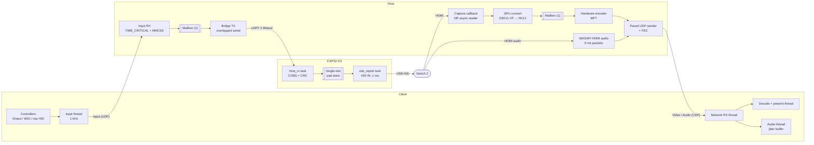
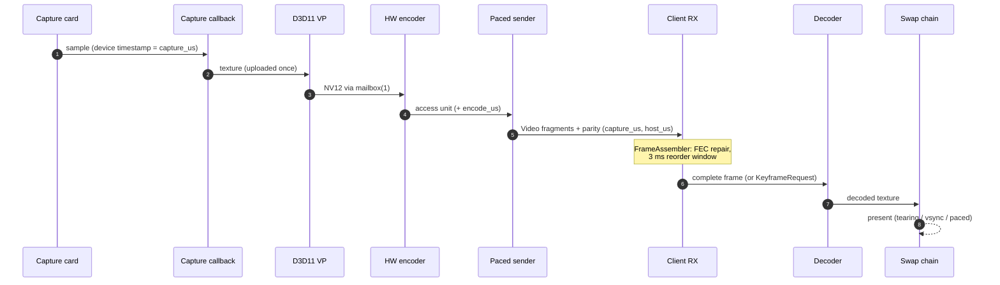
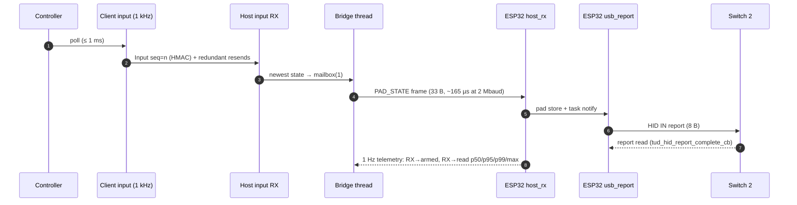
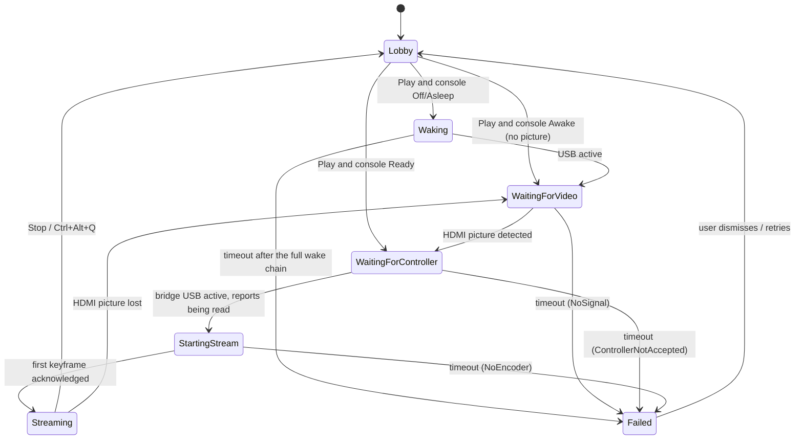

# Architecture

Hikari has three parts that talk over two protocols:

| Component | Runs on | Talks to | Code |
| --- | --- | --- | --- |
| **Bridge firmware** | ESP32-S3-DevKitC-1 | Switch 2 dock over USB HID; Host over UART (`hk_link`) | `firmware/esp32-s3/`, `shared/protocol/hk_link.*` |
| **Host** | Windows PC at home | capture card (MF), GPU (D3D11), encoder MFT, WASAPI, bridge, client (UDP) | `host/src/`, `media/`, `shared/` |
| **Client** | Windows PC where you play | controllers, decoder MFT, swap chain, WASAPI, host (UDP) | `client/src/`, `media/`, `shared/` |

Host and Client are two roles of the same `Hikari.exe`. The wire formats are specified byte by byte in [protocol.md](protocol.md).

## Design rules

These rules apply in every real-time path (see `shared/common/hikari/sync.h`):

1. **No unbounded queues.** Producers never block. When a consumer falls behind, the oldest data is discarded, and the discard is counted.
2. **Newest state wins** for input. Nothing in the input path is retransmitted or acknowledged.
3. **Deadlines, not retransmission** for video. A frame that can't be completed in time is abandoned, and the client asks for a keyframe.
4. **Measure everything.** Every latency is recorded into a lock-free log-linear histogram (`shared/telemetry/hikari/histogram.h`, ≤ 6.25 % relative error). We report p50/p95/p99/max, never averages alone.
5. **Schedule only what matters.** Only threads whose wake-up latency adds directly to input or video latency get MMCSS. Nothing runs at `REALTIME_PRIORITY_CLASS`, because starving USB, network and GPU drivers *increases* jitter.

## Threads

### Host

| Thread | Role (`set_thread_role`) | Priority / MMCSS | Wakes on | Does |
| --- | --- | --- | --- | --- |
| Capture callback | Video | MF work queue | frame from the driver | Timestamps the frame (device reference time when available), uploads it to the GPU once, samples signal presence every 15th frame, requests the next sample. |
| Convert + encode | Video | `HIGHEST`, MMCSS *Games* (high) | encoder mailbox / MFT events | D3D11 video processor → NV12 ring (6 textures), submits to the hardware MFT, drains output. |
| Paced sender | Network | `HIGHEST`, MMCSS *Games* (high) | encoded frame, pacing timer | Fragments into 1200-byte datagrams, adds XOR parity, paces the burst across the frame interval with the high-resolution waitable timer. |
| Network RX / input RX | Input | `TIME_CRITICAL`, MMCSS *Games* (critical) | socket | Verifies the HMAC tag, keeps the newest `Input` by sequence number, publishes it to the bridge mailbox. Also handles control packets and receiver reports. |
| Bridge | Input | `TIME_CRITICAL`, MMCSS *Games* (critical) | pad mailbox, serial read, wake request | Overlapped `WriteFile` of the newest pad frame (pad frames always go before control frames), 40 ms keepalive, 1 Hz UART ping, telemetry parsing, reconnects. |
| Audio capture | Audio | `HIGHEST`, MMCSS *Pro Audio* | WASAPI event | Cuts 48 kHz stereo into 240-sample (5 ms) packets, optionally Opus-encodes (`RESTRICTED_LOWDELAY`). |
| Lobby / status | Background | `BELOW_NORMAL` | 250 ms timer | Fuses console state and sends `HostStatus` about 4× per second. Runs the Play state machine, discovery replies, tray UI. |

The process runs at `ABOVE_NORMAL_PRIORITY_CLASS` and opts out of EcoQoS, so hybrid CPUs don't park it on efficiency cores. It also asks hybrid-GPU laptops for the discrete GPU (`NvOptimusEnablement`, `AmdPowerXpressRequestHighPerformance`), and keeps the system awake while streaming.

### Client

| Thread | Role | Does |
| --- | --- | --- |
| Input | Input (`TIME_CRITICAL`) | Polls XInput / Windows.Gaming.Input / raw HID (DualShock 4, DualSense) and the keyboard at **1 kHz**. Applies the mapping, then sends an `Input` packet **immediately on change**. Each change is resent redundantly over the next few ms (`kInputRedundant`), and the current state is refreshed periodically, so a single lost datagram never leaves a button stuck. |
| Network RX | Network | Receives video fragments into the `FrameAssembler`, routes audio to the jitter buffer, answers pings, sends `ReceiverReport` every ~100 ms and `KeyframeRequest` on loss. |
| Decode + present | Video | Media Foundation hardware decoder into D3D11, then a flip-model swap chain (`DXGI_SWAP_EFFECT_FLIP_DISCARD`, tearing allowed when supported). The presentation mode picks the present policy. |
| Audio | Audio (*Pro Audio*) | Jitter buffer with drift correction (small resampling adjustments keep the buffer at its target without audible clicks), WASAPI render. |
| UI | Background | Lobby, settings, Controller Settings window, stats overlay. |

### Bridge (ESP32-S3)

| Task | Core | Priority | Does |
| --- | --- | --- | --- |
| `usb_report` | 1 | `configMAX_PRIORITIES - 1` | Arms the next HID IN report the moment a new state lands. Re-sends at least every 8 ms (`HIKARI_KEEPALIVE_REPORT_MS`). Enforces the failsafe. |
| `host_rx` | 1 | `configMAX_PRIORITIES - 2` | UART events (interrupt after 16 bytes or 2 idle symbols) → COBS/CRC decoder → session and sequence checks → pad store → notifies `usb_report`. |
| TinyUSB | 0 | 22 | USB device stack. `tud_hid_report_complete_cb` timestamps the moment the console *reads* the report. |
| `wake` | 0 | 3 | Escalating wake chain. It may block for seconds, so it runs at low priority on the other core. |
| `main` | 0 | 1 | Sends 1 Hz telemetry to the host. |

## Queue policy

Every hand-off in the system, its bound, and the reason it exists:

| Queue | Where | Max depth | On overflow | Why it exists |
| --- | --- | --- | --- | --- |
| MF capture upload ring | `VideoCapture::upload_ring_` | 4 textures | oldest texture reused | System-memory frames are uploaded once and must stay valid while the converter reads them. |
| NV12 output ring | `GpuConverter::kRing` | 6 textures | wraps | Gives the encoder stable input surfaces without allocating per frame. |
| Encoder input mailbox | host, `Mailbox<frame>` | **1** | newer frame replaces older, counted as `encode_drops` | If the encoder is busy, encoding a stale frame only adds latency. |
| MFT in-flight list | `VideoEncoder::in_flight_` | what the MFT accepts (≈1–2) | MFT says `NOTACCEPTING` → frame dropped | Matches outputs to capture timestamps. |
| UDP socket buffers | `UdpSocket` | 8 MiB each way | kernel drop, counted as `send_errors` | Absorbs a keyframe burst locally. Pacing keeps it nearly empty in steady state. |
| Pad mailbox | `Bridge::pad_mailbox_` | **1** | newer state replaces older | Input is newest-state-wins. Never queue a stale stick position. |
| Bridge control frames | `Bridge::session_loop` `control` | 8 frames | extra frames dropped | Pings and wake requests. Always sent *after* pad frames. |
| Wake request | host `wake_req_` / firmware `xQueueOverwrite` | **1** | coalesced | Pressing Play twice must not queue two wake chains. |
| UART RX driver buffer | firmware | 1024 B, 16 events | `UART_FIFO_OVF` → flush and resync | ISR → task hand-off. COBS resyncs at the next `0x00`. |
| Pad store | firmware `pad_store` | **1** (spinlock) | overwritten | The report task always sends the latest state. |
| Frame assembler | client `FrameAssembler` | 16 frame slots | a frame ≥ 16 ahead abandons older ones | Reassembly and FEC repair with a 3 ms reorder window. |
| Decode queue | client `BoundedQueue<frame, N>` | small (a few frames) | flush + `KeyframeRequest(reason 2)` | Encoded frames can't be skipped: decoding depends on the previous frame. A full queue means the decoder fell behind. |
| Present | swap chain | 1 frame latency (Minimum Latency / Balanced) | newest frame wins | Decoded frames waiting for vblank are pure latency. |
| Audio jitter buffer | client | a target of a few 5 ms packets, adapted to measured jitter | drop oldest / conceal | Absorbs network jitter. Drift correction keeps it at target. |

> The ABR treats a client decode queue deeper than 2 as congestion (`abr.cpp`), so the encoder backs off before the client's queue overflows.

## Data flow: a video frame

## Data flow: a button press

## Console state fusion

The host decides what the console is doing from two independent signals: the bridge's USB bus state (`hk_usb_state`) and HDMI picture detection. The capture code samples an 8×8 luma grid over the central 80 % of the frame every 15th frame. Capture cards emit a uniform colour when there is no picture, so a standard deviation ≥ 3 counts as "picture". Two agreeing votes are needed to change state, and no frame for 1 s means no signal.

| Bridge connected | USB bus | HDMI picture | `ConsoleState` | Shown to the user |
| --- | --- | --- | --- | --- |
| no | n/a | any | `Unknown` | "Controller bridge not connected" (`HostIssue::NoBridge`) |
| yes | detached | no | `Off` | **Off.** Console off or undocked |
| yes | suspended | no | `Asleep` | **Asleep** |
| yes | any | any (wake in progress) | `Waking` | **Waking…** |
| yes | active | no | `AwakeNoVideo` | **Awake** (no picture yet, e.g. lock screen with HDMI off) |
| yes | active | yes | `Ready` | **Ready** |
| yes | detached / suspended | yes | `AwakeNoVideo`* | Picture without a controller: the bridge is probably not plugged into the dock (`ControllerNotAccepted`) |

\* An unusual combination. The host trusts the picture and reports a controller problem instead of claiming the console is asleep.

> [!NOTE]
> Which USB state a *sleeping* Switch 2 leaves the bridge in (suspended vs. detached) still needs to be confirmed on hardware. The fusion above handles both. See [remote-wake.md](remote-wake.md).

## Play state machine

`SessionPhase` in `net_protocol.h`. The host owns it and streams it to the client in `HostStatus` (phase, elapsed ms, progress 0–1000, human message), so the client can show progress at each step.

| Phase | Entered when | Leaves when | Default timeout (design) | Recovery |
| --- | --- | --- | --- | --- |
| `Lobby` | client authenticated, or stream stopped | Play received | — | — |
| `Waking` | console `Off`/`Asleep` | bridge reports USB active | 20 s (the full chain, including the optional power-button pulse) | Escalate: remote wakeup → HOME → power button. Then `Failed(WakeFailed)` with the per-method results. |
| `WaitingForVideo` | USB active, no picture | HDMI picture detected | 15 s | Send HOME once (lock screen with HDMI off), then `Failed(NoSignal)` |
| `WaitingForController` | picture present | console is reading reports (`rx_to_consumed` samples arriving, USB active) | 5 s | Re-HELLO the bridge, then `Failed(ControllerNotAccepted)` |
| `StartingStream` | controller OK | client acknowledges the first decoded keyframe | 5 s | Re-open the encoder (next-best from the benchmark), then `Failed(NoEncoder)` |
| `Streaming` | first frame shown | Stop, client lost, or picture lost | client silence > 3 s → neutral pad + back to `Lobby` | The client auto-reconnects and re-handshakes. The host keeps the console awake. |
| `Failed` | any timeout | user retries | — | `HostIssue` + `message` explain what to check |

Whenever the client goes away (Bye, silence, or the stream stops), the host immediately publishes a **neutral** pad state. Independently, the bridge forces neutral after 250 ms without valid host frames.

## Auto-detection

| What | How |
| --- | --- |
| ESP32 bridge | SetupAPI enumerates COM ports. Candidates are ranked by USB VID/PID (Espressif `303A`, CP210x `10C4:EA60`, CH343 `1A86:55D3/55D4`, other CH34x, FTDI). Each is opened **with DTR/RTS released**, so the dev board isn't reset, and confirmed with a `HELLO`/`HELLO_ACK` handshake (3 tries × 400 ms). The last good port is tried first. Rescan every 2 s. |
| Capture card | MF video capture devices scored by name (capture/HDMI/Elgato/… +, webcam/integrated/virtual −) and by having a ≥1080p59 mode. The mode is picked by resolution, then frame rate, then format preference NV12 > YUY2 > MJPEG. |
| Audio | The WASAPI capture endpoint with the same **PnP container ID** as the video device, falling back to name similarity, then generic "HDMI"/"capture" names. |
| Encoder | Every hardware H.264 MFT is benchmarked on first run (120 paced 1080p frames). Encoders that can't sustain 95 % of the frame rate are discarded. The best scores lowest on **p95 + 0.25 × p99** latency. The result is cached. |
| GPU | `EnumAdapterByGpuPreference(HIGH_PERFORMANCE)`; one D3D11 device is shared by capture, conversion and encode. |

Detected values are written back to the INI files in `%LOCALAPPDATA%\Hikari`, so the next start is instant. Any value can be overridden for one run with `--section.key=value` on the command line.
