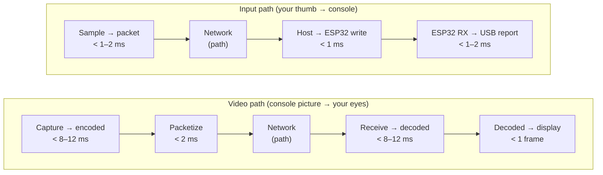

# Latency budget

Hikari treats latency as a budget. Each stage gets a share, each share has a histogram, and changes are judged by how they move **p95/p99**, not the mean.

> [!IMPORTANT]
> Everything in the first table is a **target**. The design aims for these numbers, but they have **not been measured yet**. Real results belong in the [Measured results](#measured-results) table, together with the hardware they were measured on.

## Budget (targets)

| # | Stage | Target | How Hikari measures it | Where you see it |
| --- | --- | --- | --- | --- |
| 1 | **Capture → encoded** (driver hand-off, GPU upload, colour conversion, hardware encode) | **< 8–12 ms** | `capture_us` is the MF device reference timestamp when the driver provides one (else the callback time). Encode time is the MFT submit → output histogram (`VideoEncoder::latency`). | `HostStats.encode_p50/p95/p99`, `HostStats.capture_to_send_*`; per frame in `Video.encode_us`, `Video.host_us` |
| 2 | **Packetization** (fragment + FEC + first datagram out) | **< 2 ms** | Included in `host_us` (capture → first packet sent). Pacing spreads the remaining datagrams over the frame interval *on purpose*. | Overlay "host" line; `HostStats.capture_to_send_*` |
| 3 | **Network** | whatever your path costs | RTT from `Ping`/`Pong`; one-way queueing delay above the windowed minimum | Overlay "net" line; `ReceiverReport.rtt_us`, `queue_delay_us`, `jitter_us` |
| 4 | **Client receive → decoded** (reassembly, FEC repair, hardware decode) | **< 8–12 ms** | `AssembledFrame.first_packet_us → complete_us` (reassembly), then complete → decoder output | Overlay "decode" line; `ReceiverReport.decode_p95_us` |
| 5 | **Decoded → display** | **< 1 frame** (< 16.7 ms at 60 Hz) | Present → displayed from the swap chain's frame statistics; cross-check with PresentMon | Overlay "display" line; PresentMon `MsUntilDisplayed` |
| 6 | **Controller sample → packet** | **< 1–2 ms** | Input thread: poll timestamp → `sendto` returned | Overlay "input" line |
| 7 | **Network (input, one way)** | path-dependent | `Input.client_time_us` on the host clock (clock sync) → host receive | `HostStats.input_owd_p50/p95/p99` |
| 8 | **Host receive → ESP32 write** | **< 1 ms** | Pad published to the bridge mailbox → overlapped `WriteFile` complete (`Bridge::host_write`) | `HostStats.input_host_p50/p99` |
| 9 | **ESP32 RX → USB report** | **< 1–2 ms** | Firmware: UART frame decoded → HID report armed (`rx_to_submit`), and → **console read it** (`rx_to_consumed`) | `HostStats.esp_rx_to_usb_*`, `esp_rx_to_console_*`; raw p50/p95/p99/max in the 1 Hz telemetry |

Two numbers aren't in the table because Hikari can't change them: the **console's own frame time** (game logic + render) and the **client display's** processing and scan-out. Glass-to-glass tests include both. See [profiling.md](profiling.md#glass-to-glass-with-a-camera).

### Physical floors worth knowing

These follow from the configuration, not from measurement:

| Item | Floor |
| --- | --- |
| A frame at 60 fps | 16.7 ms between frames: worst-case wait for the next frame to be captured |
| Pad frame on the UART (33 B, 2 Mbaud, 8N1) | ≈ 165 µs on the wire |
| USB full-speed HID at `bInterval = 1` | up to 1 ms until the console's next poll (the console decides its actual polling rate; `poll_interval` telemetry shows it) |
| Client controller polling at 1 kHz | up to 1 ms |

### How the stages add up

## Measured results

Fill this in from real runs. Use the method in [profiling.md](profiling.md) and keep one row per configuration. Always record p50 **and** p95/p99, and how many samples or how long the run was.

**Setup**

| | |
| --- | --- |
| Date / Hikari version | |
| Host PC (CPU, GPU, encoder chosen) | |
| Capture card (format, mode, USB port) | |
| Client PC (CPU, GPU, display Hz, VRR?) | |
| Network (LAN / Tailscale direct / DERP, wired / Wi-Fi, RTT) | |
| Stream preset / display mode | |
| Game / scene | |

**Results**

| # | Stage | p50 | p95 | p99 | max | Samples / duration | Notes |
| --- | --- | --- | --- | --- | --- | --- | --- |
| 1 | Capture → encoded | | | | | | |
| 2 | Packetization | | | | | | |
| 3 | Network RTT | | | | | | |
| 4 | Client receive → decoded | | | | | | |
| 5 | Decoded → display | | | | | | |
| 6 | Controller sample → packet | | | | | | |
| 7 | Input one-way (client → host) | | | | | | |
| 8 | Host receive → ESP32 write | | | | | | |
| 9a | ESP32 RX → report armed | | | | | | |
| 9b | ESP32 RX → console read | | | | | | |
| — | Console poll interval | | | | | | |
| — | **Glass-to-glass** (camera) | | | | | | |
| — | **Button-to-photon** (camera) | | | | | | |
