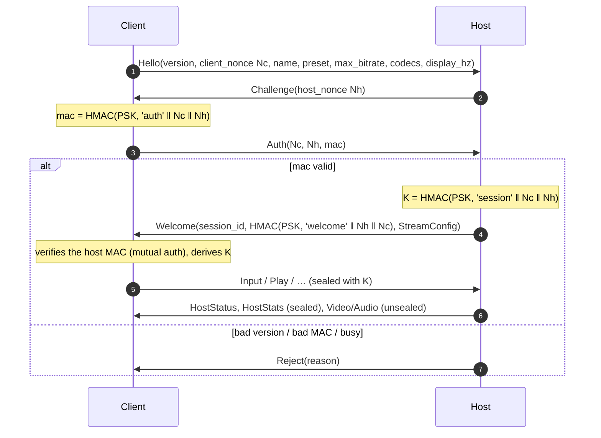

# Wire protocols

Hikari uses two protocols:

| | **`hk_link`** (wired) | **Hikari net** (UDP) |
| --- | --- | --- |
| Between | Host ⇄ ESP32-S3 bridge | Client ⇄ Host |
| Transport | UART 2 000 000 baud, 8N1, no flow control | UDP, port **47800**, dual-stack IPv6 socket |
| Framing | COBS + CRC-16, `0x00` delimiter | 1 datagram = 1 packet, ≤ 1200 bytes |
| Code | `shared/protocol/hk_link.h/.c` (C99, shared with the firmware) | `shared/protocol/hikari/net_protocol.h`, `net_protocol.cpp`, `video_transport.*`, `secure_packet.h`, `abr.*`, `shared/common/crypto.cpp` |
| Version | `HK_LINK_VERSION = 1` | `kVersion = 1`, magic `0xB7` |

**All multi-byte integers are little-endian** in both protocols. Fields are serialized explicitly, one at a time, with no struct packing. Strings are fixed-width, zero-padded byte fields.

---

## Part 1: `hk_link` (Host ⇄ ESP32)

### Framing

```
wire  = COBS( type:u8 | payload[0..93] | crc16:u16le ) 0x00
```

- **CRC**: CRC-16/CCITT-FALSE (poly `0x1021`, init `0xFFFF`, no reflection, no final XOR) over `type | payload`. The check value for `"123456789"` is `0x29B1`.
- **COBS** removes every `0x00` from the frame, so `0x00` is an unambiguous delimiter. After corruption or boot-ROM noise, the receiver resyncs at the next delimiter. Idle delimiters (empty frames) are allowed and ignored.
- **Limits**: a decoded frame (type + payload + CRC) is at most `HK_LINK_MAX_FRAME = 96` bytes. On the wire that's at most `96 + 96/254 + 2 = 98` bytes. The decoder counts oversize, COBS and CRC failures in `frames_bad`.
- **Hot-path semantics**: no ACKs, no retransmission, no FIFO. Every pad frame carries the *full* state plus a sequence number, and the newest one wins.

| Frame | Raw (type+payload+CRC) | On the wire | Time at 2 Mbaud |
| --- | --- | --- | --- |
| `PAD_STATE` without IMU | 31 B | 33 B | ≈ 165 µs |
| `PAD_STATE` with IMU | 43 B | 45 B | ≈ 225 µs |

### Message types

| Type | Name | Direction | Payload | Purpose |
| --- | --- | --- | --- | --- |
| `0x01` | `PAD_STATE` | host → device | 28 or 40 B | Full controller state |
| `0x02` | `HELLO` | host → device | 8 B | Start a session, set the failsafe and profile |
| `0x03` | `PING` | host → device | 8 B | UART round-trip measurement (1 Hz) |
| `0x04` | `CONFIG` | host → device | — | *Reserved, not implemented yet* |
| `0x05` | `WAKE` | host → device | 3 B | Run the wake chain |
| `0x81` | `TELEMETRY` | device → host | 64 B | 1 Hz counters and latency summaries |
| `0x82` | `HELLO_ACK` | device → host | 11 B | Capabilities and console USB state |
| `0x83` | `PONG` | device → host | 12 B | Reply to `PING` |
| `0x84` | `EVENT` | device → host | 9 B | Asynchronous events |

### `PAD_STATE` (0x01)

| Offset | Size | Field | Notes |
| --- | --- | --- | --- |
| 0 | u8 | `version` | must be `1` |
| 1 | u8 | `flags` | bit0 `HAS_IMU`, bit1 `LATENCY_MARK`, bit2 `NEUTRAL` |
| 2 | u32 | `session_id` | must match the current `HELLO` session, otherwise counted as stale |
| 6 | u32 | `seq` | must be newer than the last one (wrap-safe `(int32)(a-b) > 0`) |
| 10 | u32 | `host_time_us` | low 32 bits of the host QPC clock |
| 14 | u32 | `buttons` | see the button table |
| 18 | u16 ×4 | `lx, ly, rx, ry` | 0..65535, centre 32768, **+Y is down** (HID convention) |
| 26 | u8 ×2 | `lt, rt` | 0..255 |
| 28 | i16 ×3 | `gyro` | only if `HAS_IMU` |
| 34 | i16 ×3 | `accel` | only if `HAS_IMU` |

Payload length must be exactly 28 (no IMU) or 40 (IMU), and must agree with the `HAS_IMU` flag.

**Buttons** (Nintendo naming; bits 0–13 equal the HORI report's button bits):

| Bit | Button | Bit | Button | Bit | Button |
| --- | --- | --- | --- | --- | --- |
| 0 | Y | 7 | ZR | 13 | Capture |
| 1 | B | 8 | − (Minus) | 16 | D-pad Up |
| 2 | A | 9 | + (Plus) | 17 | D-pad Down |
| 3 | X | 10 | L-stick click | 18 | D-pad Left |
| 4 | L | 11 | R-stick click | 19 | D-pad Right |
| 5 | R | 12 | HOME | | |
| 6 | ZL | | | | |

The D-pad becomes a hat (0 = up, clockwise, 8 = centred). Opposite directions pressed together cancel out (SOCD → neutral).

### `HELLO` (0x02) / `HELLO_ACK` (0x82)

`HELLO`

| Offset | Size | Field | Notes |
| --- | --- | --- | --- |
| 0 | u8 | `version` | `1` |
| 1 | u32 | `session_id` | random, odd. A new session resets the sequence tracking. |
| 5 | u16 | `failsafe_timeout_ms` | the host sends 250. Values < 20 are ignored. |
| 7 | u8 | `profile` | `0` = HORI wired pad, `1` = Pro Controller (reserved) |

`HELLO_ACK`

| Offset | Size | Field |
| --- | --- | --- |
| 0 | u8 | `link_version` |
| 1 | u8 | `profile` |
| 2 | u16 | `fw_version` (major << 8 \| minor) |
| 4 | u32 | `session_id` (echo) |
| 8 | u8 | `usb_state`: 0 detached, 1 suspended, 2 active |
| 9 | u8 | `wake_methods` supported (`HK_WAKE_*` mask) |
| 10 | u8 | `remote_wakeup_enabled`: the console armed USB remote wakeup |

### `PING` (0x03) / `PONG` (0x83)

`PING`: `seq:u32, host_time_us:u32`. `PONG`: `seq:u32, host_time_us:u32 (echo), device_time_us:u32`. The host records the round trip in a rolling histogram (`BridgeStatus::link_rtt`).

### `WAKE` (0x05)

| Offset | Size | Field |
| --- | --- | --- |
| 0 | u8 | `methods`: bit0 USB remote wakeup, bit1 HOME press, bit2 power button, bit3 HDMI-CEC (reserved) |
| 1 | u16 | `press_ms`: HOME hold / power-button pulse. 0 → defaults (120 ms HOME, 150 ms power). The power pulse is clamped to 20–5000 ms. |

Requests are coalesced: a pending request is replaced, never queued. See [remote-wake.md](remote-wake.md) for the chain's logic.

### `TELEMETRY` (0x81), 64 bytes, 1 Hz

| Offset | Size | Field |
| --- | --- | --- |
| 0 | u32 | `uptime_ms` |
| 4 | u32 | `session_id` |
| 8 | u32 | `rx_packets`: valid pad frames |
| 12 | u32 | `rx_invalid`: COBS/CRC/length/type errors |
| 16 | u32 | `rx_seq_gaps`: valid frame whose `seq` ≠ previous + 1 |
| 20 | u32 | `rx_stale`: wrong session or old `seq` |
| 24 | u32 | `usb_reports`: HID reports armed |
| 28 | u32 | `usb_fail` |
| 32 | u16 | `usb_reports_per_s` |
| 34 | u16 | `rx_packets_per_s` |
| 36 | 4×u16 | `rx_to_submit` p50/p95/p99/max (µs): UART frame received → HID report armed |
| 44 | 4×u16 | `rx_to_consumed` p50/p95/p99/max (µs): UART frame received → **console read the report** |
| 52 | 4×u16 | `poll_interval` p50/p95/p99/max (µs): between console reads |
| 60 | u8 | `usb_state` |
| 61 | u8 | `failsafe_active` |
| 62 | u8 | `remote_wakeup_enabled` |
| 63 | u8 | reserved (0) |

Latency values saturate at 65535 µs. The firmware histograms use 25 µs linear buckets up to 20 ms, are double-buffered and are reset every report, so each report covers the last second.

### `EVENT` (0x84)

`code:u8, device_time_us:u32, arg:u32`

| Code | Name | `arg` |
| --- | --- | --- |
| 1 | `USB_STATE` | new `hk_usb_state` |
| 3 | `FAILSAFE` | 1 entered, 0 left |
| 4 | `LATENCY_MARK` | `seq` of the pad state that pulsed the marker GPIO |
| 5 | `WAKE` | `(method << 8) \| result`. Result: 1 sent, 2 unsupported, 3 not permitted (console didn't arm remote wakeup), 4 already awake |

### Session rules (firmware)

- A `PAD_STATE` with a foreign `session_id` is dropped (`rx_stale`). This protects against frames left in buffers from a previous host run.
- A `PAD_STATE` whose `seq` is not newer is dropped (`rx_stale`), and a gap is counted (`rx_seq_gaps`).
- `HELLO`, `PING` and valid `PAD_STATE` frames all refresh the failsafe timer. After `failsafe_timeout_ms` (default 250 ms) with nothing, the bridge publishes a neutral state (all released, sticks centred) and emits `EVENT FAILSAFE 1`.
- The host sends a keepalive copy of the held state (fresh `seq`) every 40 ms, so the failsafe fires only when the host or client is really gone.
- Each HID report is re-sent at least every 8 ms even without changes.

---

## Part 2: Hikari net (Client ⇄ Host)

### Common header

Every datagram starts with 6 bytes:

| Offset | Size | Field |
| --- | --- | --- |
| 0 | u8 | `magic` = `0xB7` |
| 1 | u8 | `type` |
| 2 | u32 | `session` (0 before `Welcome` assigns one) |

Datagrams are capped at **1200 bytes** (`kMaxDatagram`). That fits inside the 1280-byte WireGuard/Tailscale MTU with room for IPv6 and UDP headers, so nothing ever gets IP-fragmented.

### Authentication classes

| Class | Packets | Protection |
| --- | --- | --- |
| Handshake | `Hello`, `Challenge`, `Auth`, `Welcome`, `Reject` | MACs carried inside the body (see the handshake) |
| **Sealed** | everything that can affect the console or the session: `Input`, `Play`, `Stop`, `Power`, `SetPreset`, `KeyframeRequest`, `ReceiverReport`, `Ping/Pong`, `HostStatus`, `HostStats`, `StreamConfig`, `Bye` | 8-byte truncated **HMAC-SHA256** over header + body, appended at the end, keyed with the per-session key. Verified in constant time. |
| Media | `Video`, `VideoParity`, `Audio` | none. They can't drive the console, and confidentiality comes from the VPN overlay. |
| Discovery | `Discover`, `DiscoverReply` | none. They reveal only the host's display name and a stable host ID. |

> [!IMPORTANT]
> Hikari **authenticates** but doesn't encrypt. Over Tailscale/WireGuard everything is encrypted by the tunnel. On a plain LAN, media packets are readable by anyone on that network.

### Pairing and handshake

The host shows a pairing code of 12 Crockford base32 characters (60 bits), such as `K7QM-2XPA-9TRB`. Normalization uppercases the code, drops separators, and maps `O→0`, `I/L→1` and `U→V`.

```
n    = "hikari-pair-v1:" + normalize(code)
d0   = SHA256(n)
d_i  = SHA256(d_{i-1} || n)     for i = 1..20000
PSK  = d_20000                  (light stretching against offline guessing)
```



- Both nonces are 16 random bytes (`BCryptGenRandom`), so each session gets a fresh key. A captured `Input` can't be replayed into a later session, and within a session the host keeps only `seq`-newer inputs.
- `Welcome.mac` proves that the host also knows the PSK, so a client can't be lured to a fake host.
- `RejectReason`: 1 `BadVersion`, 2 `BadAuth`, 3 `Busy`.

### Packet types

| Type | Name | Dir | Body | Notes |
| --- | --- | --- | --- | --- |
| 1 | `Hello` | C→H | 59 / 60 B | Optional trailing `flags` byte. `kHelloProbe` (bit 0): verify the pairing only. The host answers with a `Welcome` whose `session_id` is 0 and leaves any active session alone (used by the client's Connect window). |
| 2 | `Challenge` | H→C | 16 B | |
| 3 | `Auth` | C→H | 64 B | |
| 4 | `Welcome` | H→C | 104 / 136 B | Optional trailing 32-byte host display name. |
| 5 | `Reject` | H→C | 1 B | |
| 6 | `Bye` | both | 0 / 1 B | Graceful disconnect; optional `reason`: 0 closed, 1 **replaced** (another client took over: the client stops reconnecting and asks before taking the host back), 2 timeout. The host publishes a neutral pad. |
| 10 | `Input` | C→H | 27 / 39 B | |
| 20 | `Video` | H→C | 26 B + ≤ 1168 B | |
| 21 | `VideoParity` | H→C | 26 B + parity | |
| 22 | `StreamConfig` | H→C | 68 B | Mid-stream reconfiguration (ABR mode change, codec) |
| 30 | `Audio` | H→C | 16 B + payload | |
| 40 / 41 | `Ping` / `Pong` | both | 12 / 20 B | Clock sync and RTT |
| 42 | `ReceiverReport` | C→H | 52 B | Every ~100 ms. Drives the ABR. |
| 43 | `KeyframeRequest` | C→H | 5 B | |
| 44 | `HostStats` | H→C | 115 B | 1 Hz overlay telemetry |
| 45 | `SetPreset` | C→H | 5 B | |
| 46 | `LatencyProbe` | — | — | *Reserved* |
| 48 | `HostStatus` | H→C | 125 B | ~4 Hz while connected |
| 49 | `Play` | C→H | 1 B | |
| 50 | `Stop` | C→H | — | |
| 51 | `Power` | C→H | 1 B | |
| 60 | `Discover` | C→broadcast | — | LAN discovery |
| 61 | `DiscoverReply` | H→C | 44 B | |

Offsets below are relative to the start of the body (after the 6-byte header). The 8-byte tag, when present, comes after the body.

#### `Hello` (1)

| Off | Size | Field |
| --- | --- | --- |
| 0 | u16 | `version` (1) |
| 2 | 16 B | `client_nonce` |
| 18 | 32 B | `client_name` |
| 50 | u8 | `preset`: 0 Minimum Latency, 1 Balanced, 2 Quality |
| 51 | u32 | `max_bitrate_kbps` (default 20000) |
| 55 | u8 | `video_codecs`: bit0 H.264, bit1 HEVC |
| 56 | u8 | `audio_codecs`: bit0 PCM, bit1 Opus |
| 57 | u16 | `display_hz` |

#### `Challenge` (2), `Auth` (3)

`Challenge`: `host_nonce[16]`. `Auth`: `client_nonce[16] | host_nonce[16] | mac[32]`.

#### `Welcome` (4) and `StreamConfig` (22)

`Welcome` = `session_id:u32 | mac[32] | StreamConfig`. `StreamConfig`:

| Off | Size | Field |
| --- | --- | --- |
| 0 | u8 | `codec`: 1 H.264, 2 HEVC |
| 1 | u16 | `width` |
| 3 | u16 | `height` |
| 5 | u16 | `fps` |
| 7 | u32 | `bitrate_kbps` |
| 11 | u8 | `audio`: 0 none, 1 PCM s16, 2 Opus |
| 12 | u32 | `audio_rate` (48000) |
| 16 | u8 | `audio_channels` (2) |
| 17 | u16 | `audio_frame_samples` (240 = 5 ms) |
| 19 | u8 | `fec_group` (K, 0 = off) |
| 20 | 48 B | `encoder_name` |

#### `Input` (10)

| Off | Size | Field |
| --- | --- | --- |
| 0 | u32 | `seq` |
| 4 | u64 | `client_time_us`: controller sample time. On the host clock when flag bit3 is set. |
| 12 | u8 | `flags`: bit0 controller connected, bit1 latency mark, bit2 redundant resend, bit3 host-clock timestamp, **bit7 has IMU** |
| 13 | u32 | `buttons` (same bits as `hk_link`) |
| 17 | i16 ×4 | `lx, ly, rx, ry`: signed, **+Y is up** (XInput convention) |
| 25 | u8 ×2 | `lt, rt` |
| 27 | i16 ×3 + i16 ×3 | `gyro`, `accel` (only if bit7) |

The host converts to the link format with `to_link_state()` (`pad_convert.h`): it inverts Y, offsets to unsigned, and sets ZL/ZR when the analog triggers pass 64/255, because the HORI profile has digital triggers.

#### `Video` (20) / `VideoParity` (21)

| Off | Size | Field |
| --- | --- | --- |
| 0 | u32 | `frame_id` |
| 4 | u16 | `index`: data fragment index (`Video`) or parity group index (`VideoParity`) |
| 6 | u16 | `data_count`: data fragments in this frame |
| 8 | u8 | `flags`: bit0 keyframe, bit1 recovery (first frame after a keyframe request) |
| 9 | u8 | `fec_group`: K (0 = no parity) |
| 10 | u32 | `frame_size`: total encoded bytes |
| 14 | u64 | `capture_us`: host clock, when the frame left the capture card |
| 22 | u16 | `encode_us`: encode duration |
| 24 | u16 | `host_us`: capture → first packet sent |
| 26 | ≤ 1168 B | payload (`kVideoPayload = 1200 − 6 − 26`) |

#### `Audio` (30)

`seq:u32 | capture_us:u64 | codec:u8 | channels:u8 | samples:u16 | payload`. With PCM, 240 samples × 2 channels × 2 bytes = 960 bytes of payload. With Opus (`RESTRICTED_LOWDELAY`, 160 kbps), one 5 ms frame per packet.

#### `Ping` (40) / `Pong` (41)

`Ping`: `seq:u32 | sender_us:u64`. `Pong`: `seq:u32 | echo_us:u64 | remote_us:u64`.

#### `ReceiverReport` (42)

| Off | Size | Field |
| --- | --- | --- |
| 0 | u32 | `highest_frame` |
| 4 | u32 | `interval_us` covered by this report |
| 8 | u32 | `packets_received` |
| 12 | u32 | `packets_lost` |
| 16 | u32 | `bytes_received` |
| 20 | u32 | `frames_complete` |
| 24 | u32 | `frames_dropped` |
| 28 | u32 | `frames_fec_recovered` |
| 32 | u32 | `rtt_us` |
| 36 | u32 | `jitter_us` |
| 40 | i32 | `queue_delay_us`: current one-way delay above its windowed minimum |
| 44 | u16 | `decode_queue` |
| 46 | u16 | `decode_p95_us` |
| 48 | u16 | `present_fps_x100` |
| 50 | u16 | `audio_buffer_ms` |

#### `KeyframeRequest` (43)

`last_good_frame:u32 | reason:u8` (1 loss, 2 decoder error, 3 startup).

#### `HostStats` (44)

| Off | Size | Field |
| --- | --- | --- |
| 0 | u16 ×2 | `capture_fps_x100`, `encode_fps_x100` |
| 4 | u32 ×2 | `capture_drops`, `encode_drops` |
| 12 | u32 | `bitrate_kbps` |
| 16 | u16 ×3 | `width`, `height`, `fps` |
| 22 | u16 ×3 | `capture_to_send` p50/p95/p99 (µs) |
| 28 | u16 ×3 | `encode` p50/p95/p99 (µs) |
| 34 | i32 ×3 | `input_owd` p50/p95/p99: controller sampled on the client → received by the host (µs, one way) |
| 46 | u16 ×2 | `input_host` p50/p99: host receive → serial write complete |
| 50 | u8 ×3 | `esp_connected`, `esp_usb_mounted`, `esp_failsafe` |
| 53 | u16 | `esp_reports_per_s` |
| 55 | u16 ×2 | `esp_rx_to_usb` p50/p99 |
| 59 | u16 ×2 | `esp_rx_to_console` p50/p99 |
| 63 | u16 | `esp_link_rtt_p50` |
| 65 | u16 | `input_rate` (Input packets/s) |
| 67 | 48 B | `encoder_name` |

#### `SetPreset` (45)

`preset:u8 (0..2) | max_bitrate_kbps:u32`.

#### `HostStatus` (48)

| Off | Size | Field |
| --- | --- | --- |
| 0 | u8 | `console`: 0 Unknown, 1 Off, 2 Asleep, 3 Waking, 4 AwakeNoVideo, 5 Ready |
| 1 | u8 | `phase`: 0 Lobby, 1 Waking, 2 WaitingForVideo, 3 WaitingForController, 4 StartingStream, 5 Streaming, 6 Failed |
| 2 | u8 | `issue`: 0 None, 1 NoBridge, 2 NoCapture, 3 NoSignal, 4 NoEncoder, 5 WakeFailed, 6 ControllerNotAccepted |
| 3 | u8 ×4 | `bridge_ok`, `capture_ok`, `signal_ok`, `encoder_ok` |
| 7 | u8 | `wake_methods` (`HK_WAKE_*`) |
| 8 | u8 | `remote_wakeup` |
| 9 | u16 | `phase_elapsed_ms` |
| 11 | u16 | `phase_progress` (0..1000) |
| 13 | 32 B | `host_name` |
| 45 | 80 B | `message` |

#### `Play` (49), `Stop` (50), `Power` (51)

`Play`: `wake:u8` (1 = wake the console if needed). `Stop`: no body. `Power`: `action:u8` (1 Wake, 2 Sleep).

#### `Discover` (60) / `DiscoverReply` (61)

The client broadcasts `Discover` to UDP 47800. Each host replies with `version:u16 | port:u16 | host_name[32] | host_id[8]`. The stable `host_id` lets the client match a saved pairing.

---

## Video transport

### Fragmentation and FEC

`VideoPacketizer` splits one encoded access unit into `N = ceil(size / 1168)` data fragments. When `fec_group = K > 0`, it emits a **parity fragment after every K data fragments** (and after the last, possibly short, group). Each parity fragment is the XOR of its group:

```
data:   D0 D1 D2 D3 | D4 D5 D6 D7 | D8 D9
parity:             P0            P1     P2        (K = 4)
P0 = D0 ⊕ D1 ⊕ D2 ⊕ D3   (shorter fragments are zero-padded; the parity is as long as the group's first fragment)
```

- **Any single loss inside a group is repaired locally**, without a round trip. Two losses in one group make the frame unrecoverable.
- Overhead is `1/K`. The host picks K from smoothed loss (see the ABR section): off on a clean path, then K = 10, 6 or 4 as loss rises.

### Reassembly and deadlines (`FrameAssembler`)

- 16 frame slots indexed by `frame_id % 16`. Packets with inconsistent headers are ignored. Duplicates are counted.
- Frames are delivered **in order**. If the frame we're waiting for is incomplete:
  - and a newer frame is in flight, it's abandoned once it has been idle for the **reorder window** (default **3 ms**);
  - and nothing newer exists, it's abandoned after **60 ms** idle (the tail of a stream was lost);
  - a frame that never arrived at all is skipped once a newer frame has been in flight for the reorder window;
  - a packet ≥ 16 frames ahead abandons everything older instead of stalling.
- Any abandonment raises a loss event. The next delivered frame is marked `after_loss`, and the client sends `KeyframeRequest(reason 1)`. Because the GOP is effectively infinite, decoding resumes on the next IDR, which the encoder produces on demand.
- **No retransmission, ever**: at 60 fps a retransmitted fragment would arrive after the frame stopped mattering.

### Pacing

The sender spreads each frame's datagrams across the frame interval instead of bursting them. Bursting overflows shallow router and Wi-Fi buffers, causes loss, and inflates queueing delay. Pacing uses the high-resolution waitable timer (`PreciseTimer`) with a short final spin.

---

## Clock sync

`ClockSync` (`sync.h`) keeps the last 32 `Ping`/`Pong` samples and uses the offset from the **minimum-RTT** sample. Queueing can only inflate RTT, so the fastest exchange is the most symmetric one. With a converged offset, the client stamps `Input.client_time_us` on the host clock (`kInputHostClock`). The host can then measure true one-way input latency (`HostStats.input_owd_*`), and the client can compute capture→display latency from `Video.capture_us`.

---

## Adaptive bitrate (`abr.cpp`)

The host runs the controller on every `ReceiverReport` (~100 ms). Its signals, in order of trust:

1. **Queueing delay**: one-way delay above its recent minimum. It rises *before* loss on a bottleneck.
2. **Loss** after FEC.
3. **Client decode queue**: more than 2 frames queued means the client can't keep up.

Smoothing: loss uses fast attack (α = 0.5) and slow release (α = 0.15). Queueing delay uses α = 0.6 rising and α = 0.2 falling.

| Condition | Action |
| --- | --- |
| `congested` = qdelay > preset limit **or** decode queue > 2 | bitrate × 0.85, and no higher than 90 % of what actually arrived. At most every 250 ms. |
| `heavy_loss` = smoothed loss > 8 % | bitrate × 0.7. At most every 250 ms. |
| clean (not congested, loss < 2 %) for 1 s, 2 s after the last decrease | bitrate × 1.06 + 200 kbps. At most every 500 ms, capped at the preset max. |

| Preset | Start | Max | Queueing-delay limit |
| --- | --- | --- | --- |
| Minimum Latency | 10 Mbps | 15 Mbps | 6 ms |
| Balanced | 12 Mbps | 20 Mbps | 12 ms |
| Quality | 18 Mbps | 35 Mbps | 25 ms |

The client's `Hello.max_bitrate_kbps` further caps the max. The floor is 2 Mbps.

**FEC group size** follows residual random loss (loss without queueing is not congestion):

| Smoothed loss | K |
| --- | --- |
| > 4 % | 4 (25 % overhead) |
| > 1.5 % | 6 |
| > 0.3 % | 10 |
| clean for 5 s | off |

FEC turns on or strengthens immediately, but only turns off after 5 s of clean reports.

**Resolution ladder.** Frame rate is protected, so resolution steps down first:

| Step | Mode | Step down when bitrate stays below | for |
| --- | --- | --- | --- |
| 0 | 1080p60 (native) | 7 Mbps | 3 s |
| 1 | 900p60 | 5 Mbps | 3 s |
| 2 | 720p60 | 2.8 Mbps | 3 s |
| 3 | 720p30 | — | — |

Stepping back **up** requires the bitrate to exceed 1.4 × the threshold of the step above for 6 s. Widths are scaled from the native aspect ratio and rounded to a multiple of 16. Each mode change is announced with `StreamConfig` and starts with an IDR.

## Tailscale discovery extension

`DiscoverReply` retains its original 44-byte body (`version:u16`, `port:u16`, `host_name:32`, `host_id:8`). A host with a Tailscale IPv4 address appends the four bytes `HTS1` followed by a zero-padded 16-byte IPv4 string. New clients accept the legacy body and prefer a valid advertised `100.64.0.0/10` address when the extension is present, preserving the advertised UDP port. Old clients continue using the original prefix. Truncated extensions are rejected.

Discovery remains unauthenticated. The advertised route does not establish trust: the normal pairing challenge-response must still succeed. Adapter enumeration runs outside the host input thread; the UI snapshot refreshes the advertised address.
