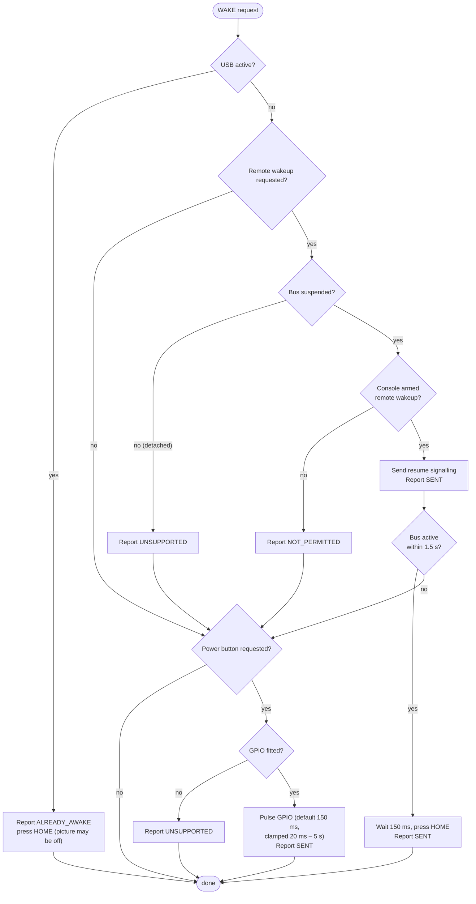

# Remote wake

You're away from home and the Switch is asleep in its dock. You press **Play**, and Hikari has to wake it up. Remote wake is a core part of Hikari, but it also depends on decisions the console makes. This page explains what Hikari does, what it can't control, and how to find out what works on *your* console.

## The honest summary

| Method | Needs | Works on Switch 2? |
| --- | --- | --- |
| **USB remote wakeup** | The console must *arm* remote wakeup for the bridge before it suspends the bus | **Unknown until tested on hardware.** Hikari detects and reports it for your console. |
| **HOME press** | The USB bus is active (console awake but showing no picture, or just resumed) | Brings the picture back from the lock or sleep screen once the bus is up |
| **Power-button fallback** | Optional extra hardware: optocoupler or actuator + one GPIO | Works whenever pressing the power button works, because it *is* a power-button press |
| HDMI-CEC | Future idea | Not implemented |

## How USB sleep and wake work

When a USB host (the dock and console) goes to sleep, it usually **suspends** the bus: it stops sending start-of-frame packets, and every device drops into low-power suspend. The device can't just start talking. Wake-up has two parts:

1. **Advertising.** The bridge's configuration descriptor sets the *Remote Wakeup* attribute (`TUSB_DESC_CONFIG_ATT_REMOTE_WAKEUP` in `profile_hori.c`). That only means the device is *capable* of it.
2. **Arming.** Before suspending, the host must send `SET_FEATURE(DEVICE_REMOTE_WAKEUP)`. Only then may the device drive *resume signalling* on the bus to wake the host. TinyUSB passes this flag to the firmware in `tud_suspend_cb(remote_wakeup_en)`.

Many consoles and PCs never arm remote wakeup for game controllers, or only for some. We don't know yet what the Switch 2 does with a wired HORI-class pad, and we won't guess.

A second unknown is **what the bridge sees while the console sleeps**. The bus might be *suspended* (dock power stays on, which is the ideal case), or the device might look *detached* (the bus goes away). The firmware reports whichever happens.

## What the firmware does

The bridge reports three things to the host continuously: in `HELLO_ACK`, in the 1 Hz `TELEMETRY` and as `EVENT`s (see [protocol.md](protocol.md#part-1-hk_link-host--esp32)).

| Field | Meaning |
| --- | --- |
| `usb_state` | `detached` (not enumerated: console off or undocked), `suspended` (enumerated, bus suspended: asleep), `active` (enumerated and polling: awake) |
| `remote_wakeup_enabled` | The console armed remote wakeup before the most recent suspend |
| `wake_methods` | What this board can do: USB remote wakeup and HOME always, the power button if `HIKARI_POWER_BUTTON_GPIO` is set |

When the host sends `WAKE(methods, press_ms)`, the `wake` task (`firmware/esp32-s3/main/wake.c`) runs this chain:



Every step emits `EVENT WAKE` with `(method << 8) | result` (1 sent, 2 unsupported, 3 not permitted, 4 already awake). The host logs each one, so after a single attempt you know which methods work on your console. Wake requests are coalesced, so pressing Play repeatedly never queues several chains.

On the host, the Play state machine waits for the bus to become active and then for an HDMI picture (see [architecture.md](architecture.md#play-state-machine)). If neither appears, the client shows **"The Switch did not wake up"** with the per-method results.

## Test your console

You need the host PC with the bridge connected, plus `hikari-pad` from the release zip.

1. With the console **awake**, check that the bridge is connected and the console sees it:

   ```powershell
   hikari-pad status
   ```

   You should see something like:

   ```
   Bridge        connected on COM5, firmware 1.0
   Console USB   active (console awake)
   Wake methods  usb home  (remote wakeup NOT enabled by console)
   ```

   plus telemetry with a non-zero USB report rate. The firmware captures the remote-wakeup flag when the console suspends the bus, so before the first sleep it always reads "NOT enabled".

2. Put the console to sleep (short press of the power button, or *Power → Sleep Mode*). Wait 10–20 seconds, then run `hikari-pad status` again:

   | `Console USB` | `remote wakeup … by console` | Meaning |
   | --- | --- | --- |
   | `suspended (console asleep)` | `enabled` | 🎉 USB remote wakeup can work. Go to step 3. |
   | `suspended (console asleep)` | `NOT enabled` | The console suspends the bus but doesn't allow wakeup. You need the power-button fallback. |
   | `detached (no console / off)` | n/a | The console cuts or resets the bus in sleep. You need the power-button fallback. |

3. Try it:

   ```powershell
   hikari-pad wake                       # default chain: --methods usb,home,power
   hikari-pad wake --methods usb         # test one method on its own
   ```

   The tool prints each wake event as it arrives (`+0.12 s  method 0x01: …`) and waits up to 8 s (`--wait`) for the console's USB to become active.

4. Please **report your result** in a GitHub issue: console model, firmware version, the `status` output asleep and awake, and the `wake` output. This is how the "Unknown" in the table above gets filled in.

## The power-button fallback

If USB wake isn't available, a GPIO pulse can press the power button for you. The firmware supports it out of the box: you only fit the hardware and set one option.

> [!WARNING]
> **This is the one part of Hikari that touches console hardware, and it is optional.**
> Wiring across the power button contacts means opening the console. That **voids your warranty** and risks damaging a device that contains a lithium battery. Do it only if you are comfortable with fine soldering, and at your own risk. A non-invasive alternative is described below.

### Option A: optocoupler across the button contacts

An optocoupler (PC817 or similar) gives full **galvanic isolation**. The ESP32 and the console share no electrical connection, and the transistor side simply shorts the button's two contacts, like your finger does.

```
   ESP32-S3 side (input)                  PC817                 Console side (output)

                                     ┌─────────────┐
   GPIO ───────[ 330 Ω ]────────────►│ 1 A     C 4 │────────────► button pad, pulled-up side
   (HIKARI_POWER_BUTTON_GPIO)        │   LED ⇒ NPN │
   GND  ────────────────────────────►│ 2 K     E 3 │────────────► button pad, ground side
                                     └─────────────┘

                  no electrical connection between the two sides
```

- **330 Ω** sets the LED current to about (3.3 V − 1.2 V) / 330 Ω ≈ 6 mA, which is plenty for a PC817 to saturate a button input.
- **Orientation matters on the output side**: the collector goes to the button pad that is *pulled up* (it measures a positive voltage to ground when the button is released), and the emitter goes to the pad that is ground. Check with a multimeter before soldering.
- Keep wires short and route them away from antennas and the battery. Use thin enamelled or Kynar wire and a little hot glue for strain relief.
- Never connect to battery terminals or power rails. You're only bridging the button.

### Option B: non-invasive actuator

A small 5 V solenoid or micro-servo mounted so it presses the console's power button from outside. Drive it from the same GPIO through a logic-level MOSFET, with a flyback diode across the solenoid. It's bulkier, but nothing inside the console is touched.

### Enable it in the firmware

```sh
cd firmware/esp32-s3
idf.py menuconfig      # Hikari bridge → Power-button emulation GPIO (e.g. 5)
                       #                → Power-button GPIO is active high (yes for the circuit above)
idf.py build flash
```

| Setting | Default | Notes |
| --- | --- | --- |
| `HIKARI_POWER_BUTTON_GPIO` | `-1` (not fitted) | Any free GPIO. Avoid strapping pins (0, 3, 45, 46), the USB pins (19, 20) and the UART pins (43, 44). |
| `HIKARI_POWER_BUTTON_ACTIVE_HIGH` | `y` | The pin idles at the inactive level from boot. |
| Pulse length | 150 ms (requested by the host) | A short press. Clamped to **20 ms – 5 s** in `board.c`, so the bridge can never hold the button long enough to force a hard power-off. |

After flashing, `hikari-pad status` lists `power` among the wake methods, and the host adds it to the chain automatically. Test it on its own with `hikari-pad wake --methods power`.

## Future: HDMI-CEC

Many TVs wake connected devices with CEC (`<Image View On>`, `<User Control Pressed: Power>`), and the protocol already reserves `HK_WAKE_HDMI_CEC`. Making a capture card speak CEC needs extra hardware on the HDMI line (CEC is a separate pin), so this is an idea for later. It would be fully non-invasive if the dock honours it.
